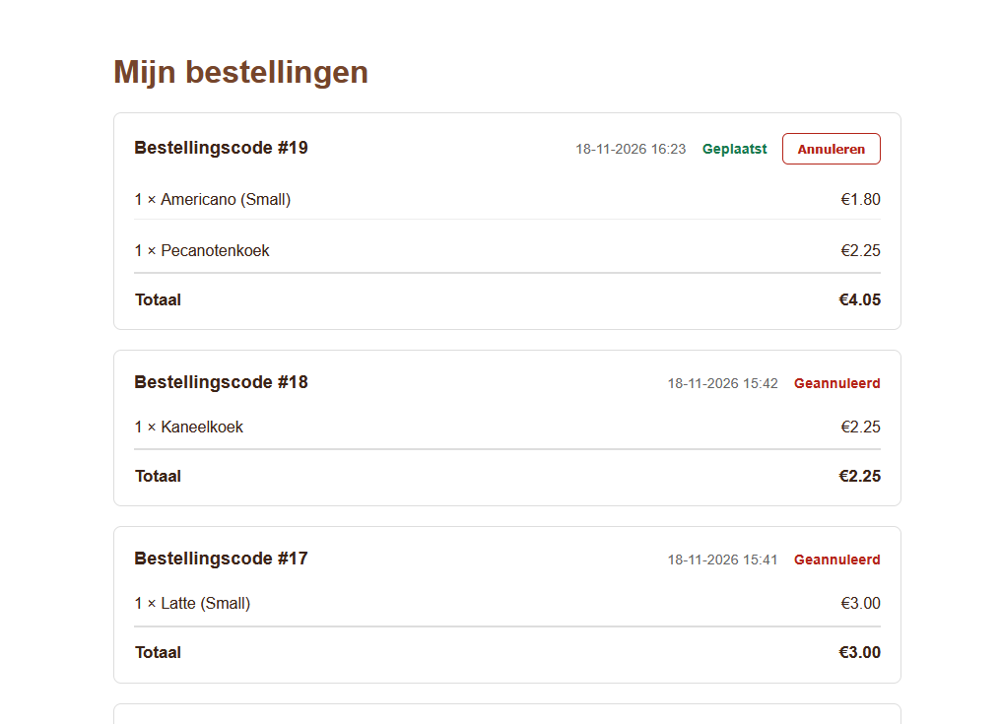
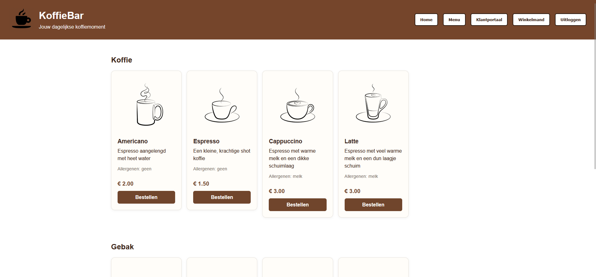
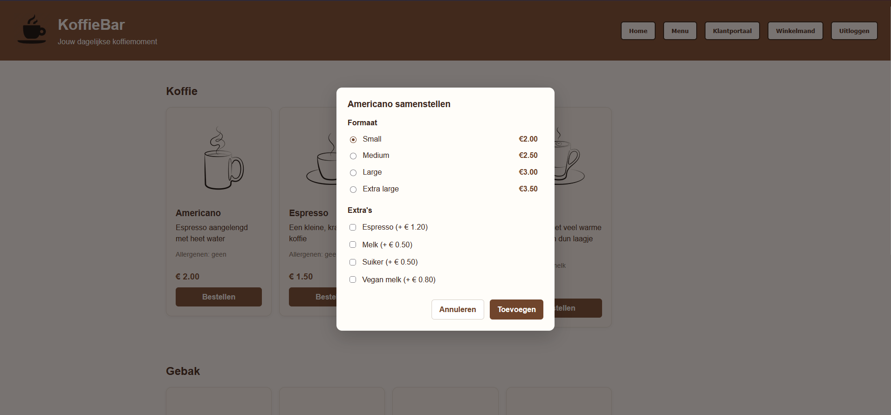
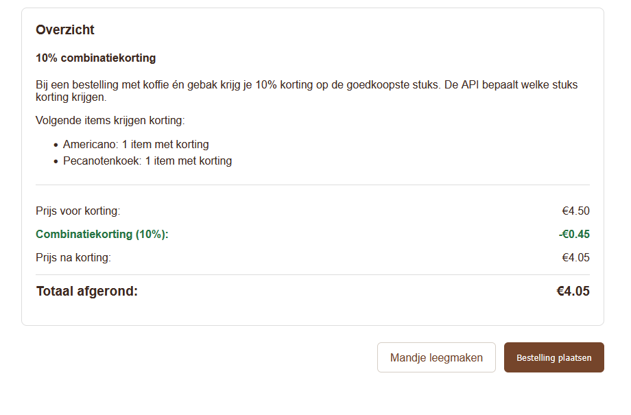

# KoffieBar

A full-stack coffee bar application built with **Angular 21** and **ASP.NET Core (.NET 10)**. KoffieBar allows customers to explore a menu, customize their orders, manage their shopping cart and place orders through a customer account.

The project was built as a portfolio project to practise full-stack development, REST API integration, authentication and database management.

## Screenshots

### Customer Portal

An overview of the customer's account and order history.



### Menu

Browse the available coffees, pastries and extras.



### Coffee Customization

Customize coffee orders by selecting sizes and additional options.



### Shopping Cart

Review selected products and order details.


Review the order total and proceed with the order.


## Features

- **Menu browsing:** View available coffees, pastries and extras.
- **Product customization:** Select coffee sizes and additional extras.
- **Shopping cart:** Add products, manage quantities and calculate totals.
- **Order management:** Place orders and view previous orders.
- **Customer accounts:** Register and log in to access personal order information.
- **Authentication:** Secure API endpoints using JWT authentication.
- **Order status:** Track and manage order statuses.
- **Discount logic:** Automatic discount when combining coffee and pastries.

## Tech Stack

| Frontend          | Backend                        |
| ----------------- | ------------------------------ |
| Angular 21        | ASP.NET Core Web API (.NET 10) |
| TypeScript        | C# 14                          |
| HTML & CSS        | Entity Framework Core          |
| RxJS & HttpClient | SQLite                         |
| Angular Routing   | JWT Authentication             |

## Project Structure

```text
KoffieBarProject/
├── KoffieBar/             # Angular frontend
│   ├── public/
│   ├── screenshots/
│   └── src/
│
├── KoffieBar.API/         # ASP.NET Core Web API
│   ├── Controllers/
│   ├── Data/
│   ├── Migrations/
│   ├── Models/
│   └── Services/
│
├── KoffieBar.API.slnx
└── README.md
```

## Getting Started

### Prerequisites

- .NET 10 SDK
- Node.js and npm
- Angular CLI

### 1. Clone the repository

```bash
git clone https://github.com/Rugbyman91/KoffieBar.git
cd KoffieBar
```

### 2. Start the backend

```bash
dotnet restore KoffieBar.API
dotnet run --project KoffieBar.API
```

The API is configured to run locally at:

`http://localhost:5274`

### 3. Start the frontend

Open a second terminal:

```bash
cd KoffieBar
npm install
ng serve
```

Open your browser at:

`http://localhost:4200`

## Development

This project is an ongoing learning and portfolio project. It focuses on building a complete application by connecting an Angular frontend to a custom ASP.NET Core API, with an emphasis on practical functionality, clean code and full-stack development.
