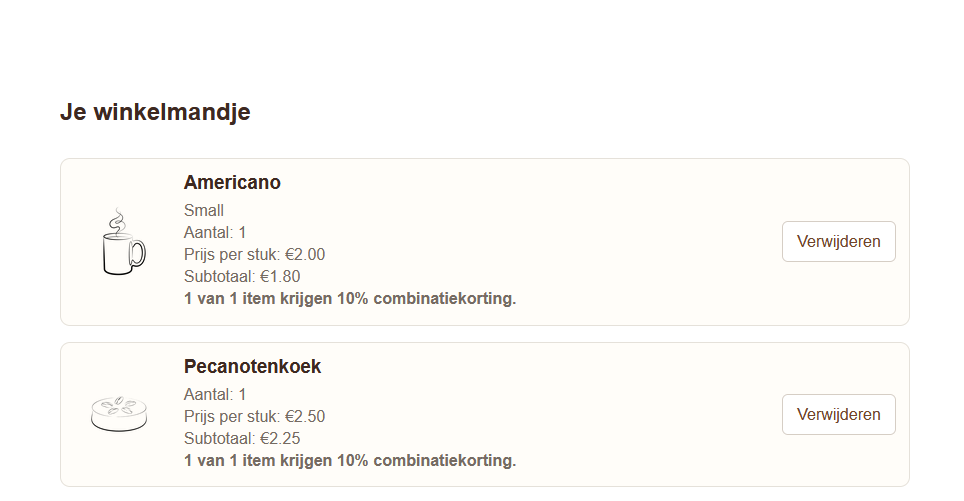

# KoffieBar

A full-stack coffee bar application built with **Angular 21** and **ASP.NET Core (.NET 10)**. KoffieBar allows customers to explore a menu, customize their orders, manage their shopping cart and place orders through a customer account.

The project was built as a portfolio project to practise full-stack development, REST API integration, authentication and database management.

## Screenshots

### Customer Portal

An overview of the customer's account and order history.


### Menu

Browse the available coffees, pastries and extras.


### Coffee Customization

Customize coffee orders by selecting sizes and additional options.


### Shopping Cart

Review selected products and order details.



Review the order total and proceed with the order.


## Features

- **Menu browsing:** View available coffees, pastries and extras.
- **Product customization:** Select coffee sizes and additional extras.
- **Shopping cart:** Add products, remove lines and see the price breakdown calculated by the API.
- **Order management:** Place orders and view previous orders.
- **Customer accounts:** Register and log in to access personal order information.
- **Authentication:** Secure API endpoints using JWT authentication.
- **Order cancellation:** Cancel an order within 30 minutes of placing it (with a confirmation step).
- **Discount logic:** Automatic discount when combining coffee and pastries.

## Business Rules

The API is the single source of truth for the menu, prices, discounts, rounding and orders. The Angular app sends product ids and quantities to `POST /api/bestellingen/berekening` and only displays the amounts it gets back.

- **Combination discount:** X = the smaller of the number of coffees and the number of pastries in the cart. The X cheapest coffees and the X cheapest pastries get 10% off.
- **Rounding:** the order total is rounded to the nearest 5 cents and the rounding amount is returned separately. It was added as an extra exercise in keeping all price logic in the API.
- **Cancellation:** an order can be cancelled until 30 minutes after it was placed. Orders cannot be edited.

## Tech Stack

| Frontend          | Backend                        |
| ----------------- | ------------------------------ |
| Angular 21        | ASP.NET Core Web API (.NET 10) |
| TypeScript        | C# 14                          |
| HTML & CSS        | Entity Framework Core          |
| RxJS & HttpClient | SQLite                         |
| Angular Routing   | JWT Authentication             |

## Project Structure

```text
KoffieBarProject/
├── KoffieBar/             # Angular frontend
│   ├── public/
│   ├── Screenshots/
│   └── src/
│
├── KoffieBar.API/         # ASP.NET Core Web API
│   ├── Controllers/
│   ├── Data/
│   ├── Migrations/
│   ├── Models/
│   ├── Properties/
│   └── Services/
│
├── KoffieBar.API.Tests/   # xUnit unit and integration tests for the API
│
├── KoffieBar.API.slnx
└── README.md
```

## Getting Started

### Prerequisites

- .NET 10 SDK
- Node.js and npm

A global Angular CLI is not required: `npm start` uses the CLI installed in the project.

### 1. Clone the repository

```bash
git clone https://github.com/Rugbyman91/KoffieBar.git
cd KoffieBar
```

### 2. Start the API

```bash
dotnet run --project KoffieBar.API
```

The API runs in the Development environment at `http://localhost:5274`. On startup the SQLite database is migrated automatically and filled with the menu data.

### 3. Install the frontend dependencies

Open a second terminal:

```bash
cd KoffieBar
npm install
```

### 4. Start the frontend

```bash
npm start
```

`npm start` runs `ng serve`. Open your browser at `http://localhost:4200`.

On Windows, PowerShell can block the `ng.ps1` script. In that case use `npm.cmd start` in PowerShell, or run the commands in a regular Command Prompt.

### Demo account

In the Development environment the API creates a demo account on startup:

- Email: `test@test.be`
- Password: `Test123!`

## Running the Tests

```bash
# API tests (xUnit), from the repository root
dotnet test

# Angular tests (Vitest), from the KoffieBar folder
npm test -- --watch=false
```

In PowerShell on Windows, `npm.cmd test -- --watch=false` works as well.

## Known Limitations

- **30-minute window:** the Angular app hides the cancel button based on the client clock, while the API checks the server clock. Edge cases around the 30-minute mark and clock differences between client and server are not handled; the API has the final say.
- **Cart storage:** the cart is stored in LocalStorage. It is emptied after placing an order, with the clear button or on manual logout, but not when the session expires.
- **Indicative price:** the coffee customization dialog shows an indicative price per size. The final prices are calculated by the API in the cart.
- **No payment:** the price of an order is calculated, but no payment logic is implemented. The 5-cent rounding is a technical exercise; online shops normally charge the exact amount.
- **Error messages:** registration errors from ASP.NET Core Identity are shown in English.
- **JWT development key:** the signing key in `appsettings.Development.json` is committed on purpose so the project runs out of the box. Replace it via the `Jwt__Key` environment variable before any public use.
- **npm audit:** `npm audit --omit=dev` reports no vulnerabilities. A plain `npm audit` still lists advisories in Angular's own build tooling (dev dependencies only), including one high-severity advisory in `undici`; the remaining automatic fix is a breaking downgrade of the Angular CLI.

## Development

This project is an ongoing learning and portfolio project. It focuses on building a complete application by connecting an Angular frontend to a custom ASP.NET Core API, with an emphasis on practical functionality, clean code and full-stack development.
